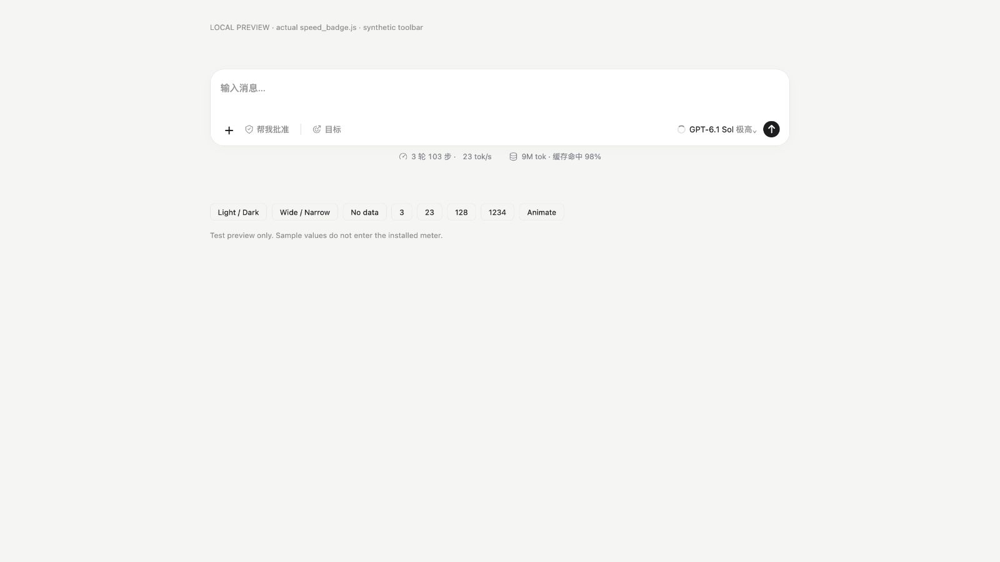

# Codex Session Stats

A local macOS companion that adds a DSH-style statistics strip below the Codex desktop composer. Built on [Agent Speed v1.4.1](https://github.com/zoefix/agent-speed/tree/v1.4.1); this is an independent integration, not an official OpenAI product.



## Features

- Completed model-call speed, including reasoning tokens and time to first token.
- Per-conversation turn/step counts, total tokens and weighted input-cache hit rate.
- Click either group for exact counts, the latest call's model, duration and completion time.
- Independent window selection, persistent history and automatic reconnection.
- Light/dark appearance, smooth numeric updates and reduced-motion support.

The strip sits **outside** the rounded input box. It does not replace Plan, Goal, permissions or model controls. The screenshot above uses synthetic values.

## Install

Requirements: macOS 14+, Swift 6+ through Xcode or Command Line Tools, and Python 3.10+. Node.js 22+ is needed only for frontend tests. No Python packages, tokenizer or API key are required.

```sh
git clone https://github.com/ToTyxp/codex-session-stats.git
cd codex-session-stats
bash codex/scripts/setup.sh
python3 codex/scripts/manage_live_speed.py install
python3 codex/scripts/manage_live_speed.py status
```

On first installation, if Codex is already open without its local debugging endpoint, quit and reopen it normally after your current response finishes. The launcher attaches through loopback CDP on `127.0.0.1` (default port `9222`, or a free port when occupied). It may perform one normal relaunch to enable that endpoint; it does not force-quit an active response. Do not expose this debugging port to the network.

For a custom data directory, set `CODEX_HOME` on the install command. Upgrades preserve that setting and the existing numeric cache. To upgrade from source, pull the changes and rerun the build/install commands.

## Metric definitions

| Metric | Meaning |
| --- | --- |
| `tok/s` | Latest eligible completed call: output tokens ÷ response wall time, including first-token wait. Agent Speed's valid interval is 500 ms–15 minutes. This is not pure server decode throughput. |
| Turns | Distinct execution `turn_id` values with completed calls. Unknown IDs are shown as unknown, not inferred from tool calls or message count. |
| Steps | Unique completed model calls; tools do not add steps. |
| Total tokens | Input + output over the conversation's own records. Cached tokens are already included in input; reasoning is already included in output. |
| Cache hit | Sum of cached input ÷ sum of all input, not an average of request percentages. |

Statistics and speed have independent eligibility rules: a valid usage record without a usable duration can still contribute to totals. The latest speed remains visible between calls. Positive speeds below 1 tok/s keep a decimal instead of rounding to zero. Child-agent conversations are not merged into their parent.

## Local data and compatibility

- Reads Codex session logs locally; it does not send telemetry, make model requests or read API credentials.
- Runtime: `~/Library/Application Support/CodexLiveSpeed`.
- One user LaunchAgent: `~/Library/LaunchAgents/local.codex.live-speed.plist`.
- Numeric cache: `runtime/completed-calls.json`; logs: `runtime/monitor.log` inside the runtime directory. Cache stores IDs, model names and numeric measurements, not conversation text.
- Only locally readable logs can be counted. Remote-host conversations with no accessible logs show unavailable data rather than another conversation's values.
- This uses temporary renderer injection and private DOM markers. Codex updates can change those markers; unknown layouts are left untouched. Official app files and their signature are not modified.
- Incomplete/malformed history is identified in the details. An unreadable file whose ownership is unknown can conservatively prevent a full-coverage claim. A truncate-and-regrow that happens entirely between polling intervals on the same inode is a remaining reader limitation.

## Stop or uninstall

```sh
python3 codex/scripts/manage_live_speed.py stop
python3 codex/scripts/manage_live_speed.py uninstall
```

Uninstall removes the LaunchAgent and injected UI. Runtime files and the numeric cache remain for recovery; delete that runtime directory manually if you no longer need them. A normal Codex relaunch without the debugging arguments closes the debugging endpoint.

## Development

```sh
bash codex/scripts/test.sh
```

This runs the integration's Python and JavaScript tests plus targeted Swift parser, statistics, cache and file-reader regressions. It does not invoke model APIs or the unrelated upstream GUI/network-traffic suites.

`codex/` contains the desktop bridge, display, installation tools and tests. `macos/Sources/AgentSpeedCodexMeter/` and `macos/Sources/AgentSpeedCore/CodexMeter/` contain the JSONL helper and session accounting. The rest of the inherited Agent Speed source is kept for provenance and shared core dependencies; its original application is documented in [README.upstream.md](README.upstream.md). Use the **Codex installation commands above**, not upstream `install.sh` or `install.ps1`.

Chinese integration notes and the numeric event contract: [codex/README.md](codex/README.md).

## Credits and license

- [Agent Speed](https://github.com/zoefix/agent-speed): Codex parsing, timing, file readers and shared core; based on v1.4.1, commit `a94a67fcc78e5d8eea5f82d8d5e737bccf994e2c`.
- [Codex Monitor](https://github.com/KevinKE93/Codex-Monitor): CDP connection and launcher foundation.
- DeepSeek Harness Desktop 2.0.17: adapted `StatsPills` styling, icons, formatting and details interaction.

MIT. Original notices are retained in [LICENSE](LICENSE) and the licenses under `codex/`. See [UPSTREAM.md](codex/UPSTREAM.md) for the adaptation boundaries.
